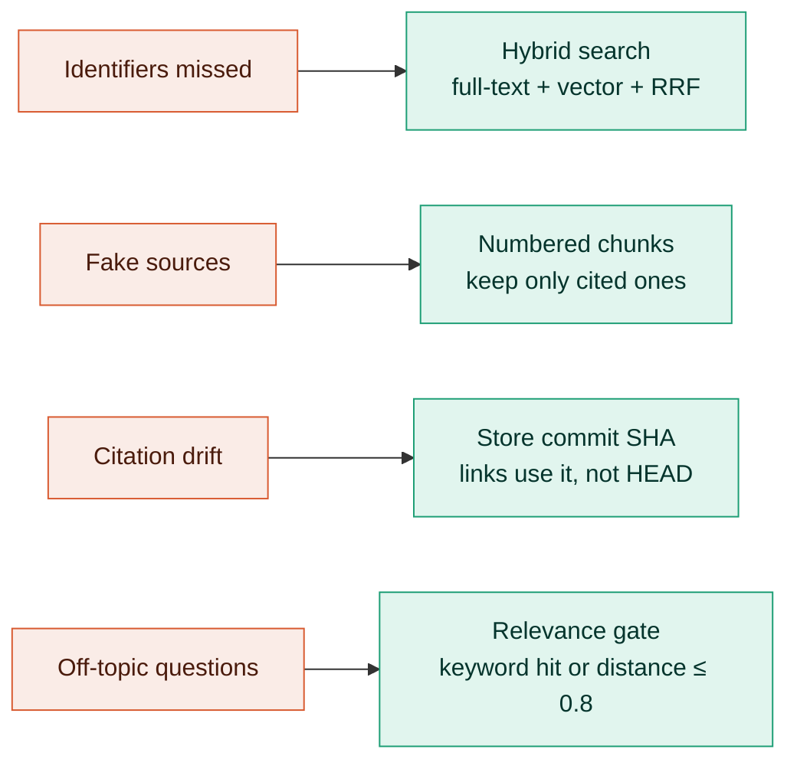
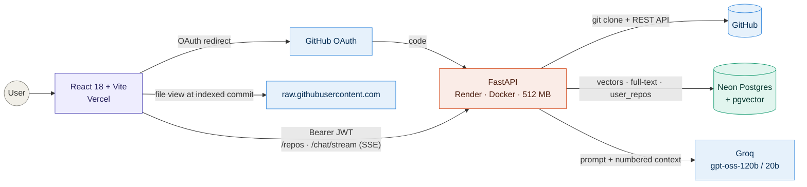
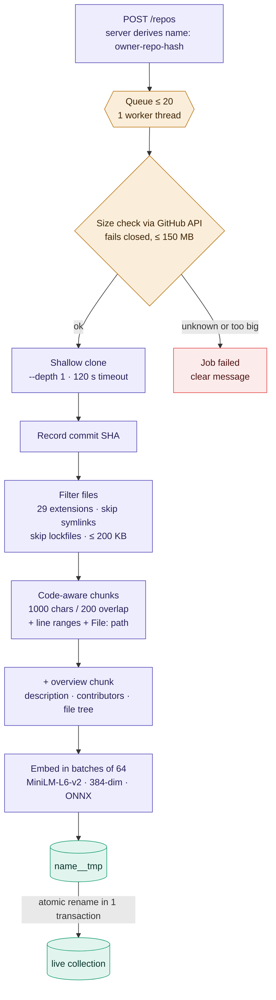
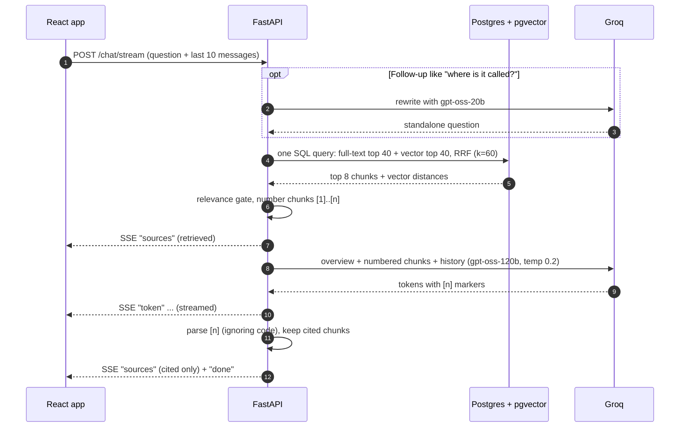
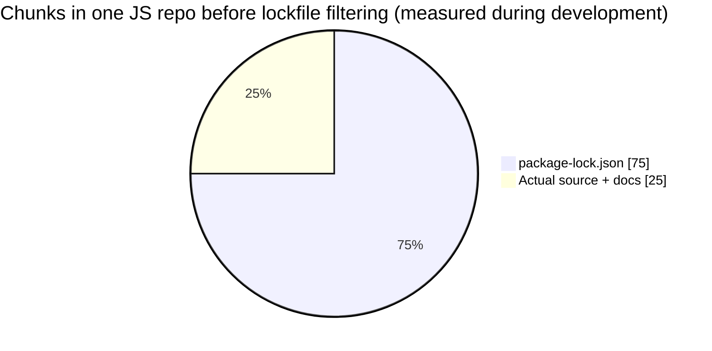

<div align="center">


<a href="https://github-gpt-using-rag.vercel.app">

</a>

<br/>

<a href="https://github-gpt-using-rag.vercel.app"></a>
<a href="https://github-gpt-api-c13y.onrender.com/docs"></a>

<br/>


<br/><br/>

**[In numbers](#in-numbers)** · **[Problem](#problem)** · **[Approach](#approach)** · **[Architecture](#architecture)** · **[Decisions & trade-offs](#decisions)** · **[Limits](#limits)** · **[Run it](#run-it)**

</div>

---

<a id="in-numbers"></a>

## 📊 In numbers

<div align="center">

<table>
<tr>
<td align="center"></td>
<td align="center"></td>
<td align="center"></td>
</tr>
<tr>
<td align="center"></td>
<td align="center"></td>
<td align="center"></td>
</tr>
<tr>
<td align="center"></td>
<td align="center"></td>
<td align="center"></td>
</tr>
</table>

</div>

> **TL;DR** — Paste a public GitHub URL, GitHub-GPT clones it, splits the code at function/class boundaries, embeds it into Postgres + pgvector and answers questions with **hybrid search** (keyword + meaning, fused with Reciprocal Rank Fusion). Every answer cites **only the chunks it actually used**, with **line ranges pinned to the exact commit** that was indexed. Built to run entirely on free tiers (Render 512 MB, Neon, Groq, Vercel).

<div align="center">

<br/>

</div>

> ⏳ The backend runs on Render's free tier — it sleeps after 15 minutes idle, so the first request can take ~50 s.

---

<a id="problem"></a>

## 🎯 The problem

Reading an unfamiliar codebase is slow. `grep` only finds exact words, and a general LLM has never seen *your* repository — so it guesses. Even typical "chat with your code" demos have three quiet failures:

| Failure | What the user sees |
| :-- | :-- |
| 🔍 **Vector search misses identifiers** | Ask about `useAuth` or `MAX_FILE_BYTES` and get vaguely related files instead of the definition |
| 🧾 **"Sources" are just the top-k results** | 8 files are listed even when the answer used one of them |
| 🕰️ **Citations drift** | Links point at `HEAD`; after one new commit, "auth.py L12–40" highlights different code |

<a id="approach"></a>

## 💡 The approach



## ✅ Results

| Area | Before | After |
| :-- | :-- | :-- |
| Exact identifier lookup | vector similarity only | **5 / 5** identifier questions (`useAuth`, `PORT`, `MAX_FILE_BYTES`, `RouteOptimizer`, "route optimizer") rank the right file **#1** in integration tests |
| Sources shown | always the top **8** retrieved | **only the chunks the answer cited** (fallback to all if the model cites none) |
| Off-topic question | **8** random chunks sent to the LLM | **0** chunks — the model says it isn't in the repo |
| Citation links | `HEAD` (drift after any commit) | the **exact indexed commit SHA** |
| Queued indexing jobs | each blocked one of FastAPI's **40** pool threads → ~40 queued repos could freeze the API | waiting jobs use **0** threads (queue + 1 worker), queue capped at **20** |
| Stuck `git clone` | no timeout | killed after **120 s** |
| GitHub API budget | **60** req/h unauthenticated | **5,000** req/h with a free token |
| Lockfile noise | `package-lock.json` was **~75 %** of a JS repo's chunks | lockfiles, minified and > 200 KB files skipped |

*Observed example: a 32-file repo (Video-Call-WebRTC) indexed into **257 chunks**; a streamed answer took **~4 s** end to end.*

---

<a id="architecture"></a>

## 🏗️ Architecture



### Indexing pipeline (background worker, once per repo)



### Question answering (one request)



### Pipeline at a glance

| Stage | Implementation | Key number |
| :-- | :-- | :-- |
| Ingestion | `git` CLI shallow clone, `GIT_TERMINAL_PROMPT=0`, commit via `git rev-parse HEAD` | 120 s timeout |
| Filtering | allow-list of extensions + `README`, `LICENSE`, `Dockerfile`, `Makefile`; symlinks and paths outside the repo skipped | 29 extensions · 200 KB max |
| Chunking | `RecursiveCharacterTextSplitter.from_language()` + exact 1-based line ranges | 15 languages · 1000 / 200 |
| Overview | GitHub API (repo, top contributors, languages) + file tree + README head, always in context | 20 contributors · 200 files · 1,500 chars |
| Embedding | `all-MiniLM-L6-v2` via **fastembed** (ONNX Runtime, 1 thread) | 384-dim · ~420 MB vs ~800 MB peak |
| Storage | `langchain-postgres` PGVector + generated `tsvector` column with GIN index | 1 shared collection per repo |
| Retrieval | full-text (`ts_rank`, identifier-aware) ∪ cosine (`<=>`), fused by **RRF** | 40 + 40 candidates → top 8 |
| Relevance gate | keep a chunk if it matched a keyword **or** cosine distance ≤ 0.8 | 0.8 cut-off |
| Query rewriting | `gpt-oss-20b`, only when the question refers back to the chat | 0 extra calls for standalone questions |
| Generation | `gpt-oss-120b`, temperature 0.2, low reasoning effort, LCEL chain | streamed via SSE |
| Citations | `[n]` markers parsed (brackets inside code ignored), overlapping ranges merged per file | only cited chunks shown |
| Memory | last 6 messages, ≤ 1,500 chars each, old `[n]` markers stripped | 6 × 1,500 |

---

<a id="decisions"></a>

## ⚖️ Engineering decisions & trade-offs

Each decision below is written as **context → decision → trade-off**. Click to expand.

<details>
<summary><b>1 · Hybrid search with Reciprocal Rank Fusion</b> — instead of vector search only</summary>

- **Context:** embeddings understand *"how does login work?"* but blur exact names like `useAuth`; keyword search is the opposite.
- **Decision:** run Postgres full-text search and pgvector cosine search in **one SQL query** (40 candidates each) and merge with RRF: `score = Σ 1 / (60 + rank)`. The tsvector splits `camelCase`, `snake_case`, dotted names and paths so identifiers match.
- **Why RRF:** it only uses ranks, so cosine distance and `ts_rank` (completely different scales) never have to be calibrated against each other. `k = 60` is the constant from the original RRF paper.
- **Trade-off:** `ts_rank` is not true BM25 (no inverse-document-frequency), and two lists cost a slightly heavier query. Falls back to vector-only if no keywords remain or the hybrid query fails.
</details>

<details>
<summary><b>2 · Verified citations</b> — show what the answer used, not what was retrieved</summary>

- **Context:** listing all top-8 chunks as "sources" overstates grounding.
- **Decision:** number chunks `[1]…[n]` in the prompt, instruct the model to cite after each sentence, parse the markers after generation (ignoring brackets inside code, so `arr[2]` isn't a citation) and send a second `sources` event with only cited chunks.
- **Trade-off:** relies on the model following instructions; if it cites nothing, all retrieved chunks are shown so the user never sees an empty list. Next step: verify each cited chunk actually supports its sentence.
</details>

<details>
<summary><b>3 · Commit-pinned citations</b> — instead of linking to <code>HEAD</code></summary>

- **Context:** the index is a snapshot; links to `HEAD` drift as soon as the repo changes.
- **Decision:** record the SHA right after cloning, store it per repo (`user_repos.commit_sha`), and build every GitHub/raw link and the file-cache key from it.
- **Trade-off:** answers reflect the indexed version, not the latest — by design. The migration is backward compatible: old rows (`NULL`) fall back to `HEAD` until re-indexed.
</details>

<details>
<summary><b>4 · Relevance gate</b> — top-k always returns k results</summary>

- **Context:** "How do I bake a cake?" still retrieved 8 chunks, inviting made-up answers.
- **Decision:** keep a chunk only if it matched a keyword of the question **or** its cosine distance is ≤ 0.8 (configurable).
- **Trade-off:** too strict drops useful chunks, too loose lets noise in. 0.8 is a starting value; vector distances are logged per chunk so it can be tuned against the evaluation set.
</details>

<details>
<summary><b>5 · Queue + one worker thread</b> — instead of FastAPI BackgroundTasks</summary>

- **Context:** background tasks run in FastAPI's shared thread pool (40 threads). Waiting jobs sat *inside* those threads, blocked on the indexing lock — about 40 queued repos could freeze every endpoint.
- **Decision:** jobs wait in a `queue.Queue` (costs no thread); a single daemon worker indexes them one by one; the queue is capped at 20 (→ HTTP 503).
- **Trade-off:** still in memory — a restart loses queued jobs and the design assumes one backend instance. A Postgres `SKIP LOCKED` or Redis queue removes both limits.
</details>

<details>
<summary><b>6 · Fail closed</b> — when in doubt, don't proceed</summary>

- **Size check:** if GitHub can't confirm the repo size (rate limit, missing or private repo), indexing stops instead of treating it as 0 MB and risking an out-of-memory crash.
- **Clone:** hard 120 s timeout, credential prompts disabled, half-downloaded folders deleted.
- **Secrets:** `JWT_SECRET` has no default and must be ≥ 32 characters — the server refuses to boot without a real one.
- **Trade-off:** a few more "try again later" messages in exchange for never silently doing the unsafe thing.
</details>

<details>
<summary><b>7 · Server-side collection naming</b> — never trust the client with a storage key</summary>

- **Context:** names were built in the browser as `owner-repo`, so `foo/bar-baz` and `foo-bar/baz` both became `foo-bar-baz` — a second user could get another repo's answers, or overwrite it with a re-index.
- **Decision:** the server derives `slug + "-" + sha256("owner/repo")[:8]` (e.g. `foo-bar-baz-cd6ffb27`) and ignores any client-sent name. GitHub names are case-insensitive, so the canonical form is lowercased.
- **Trade-off:** names are less pretty; repos indexed under old names need one re-add.
</details>

<details>
<summary><b>8 · Symlink-safe ingestion</b> — a repo must not read the server</summary>

- **Context:** git preserves symlinks. A file `notes.txt → /proc/self/environ` would have been indexed, putting the server's own API keys and database URL into the vector store — reproduced with a test repo.
- **Decision:** skip symlinks and any path whose resolved location is outside the clone.
- **Trade-off:** none worth mentioning — legitimate repos rarely rely on symlinked source files.
</details>

<details>
<summary><b>9 · Atomic re-index (blue-green swap)</b></summary>

- New vectors go into `<name>__tmp`; one SQL transaction deletes the old collection and renames the temp one. Users keep chatting with the old index during a re-index, and a crash never exposes a half-built index.
- **Trade-off:** needs double the storage for that repo while re-indexing.
</details>

<details>
<summary><b>10 · pgvector on Postgres</b> — instead of Pinecone / Chroma</summary>

- One database holds vectors, full-text index and user data → hybrid search in a single round trip and transactional swaps; free on Neon and survives redeploys (free hosts have no persistent disk).
- **Trade-off:** dedicated vector databases scale approximate search to millions of vectors better. Here search is an **exact scan** per repo (≤ 8,000 chunks) — perfect recall and fast enough. At scale: HNSW index + per-repo partitioning (a `WHERE collection = …` filter after approximate search can return fewer than k results).
</details>

<details>
<summary><b>11 · Local ONNX embeddings</b> — instead of PyTorch or an embedding API</summary>

- `all-MiniLM-L6-v2` via fastembed runs on CPU with ONNX Runtime: **~420 MB** peak with 1 thread vs **~800 MB** default — fits the 512 MB instance; no per-chunk network calls or API cost.
- **Trade-off:** a general English model with a short input window, weaker on code than code-specific embeddings. Hybrid search covers much of the gap for identifiers.
</details>

<details>
<summary><b>12 · Smaller choices</b></summary>

- **Query condensation only when needed** — saves an LLM call (~0.5–2 s) on standalone questions; risk: the heuristic can miss a follow-up.
- **Overview chunk always in context** — answers "what is this project / who built it", which no single code chunk can.
- **Shared vectors, per-user links** — a public repo is embedded once for everyone; `user_repos` keeps workspaces separate.
- **Stateless JWT, 4-hour lifetime** — no session store; logout only clears the browser copy, so the short lifetime limits how long a stolen token works. Token delivered in the URL fragment so it never reaches server logs.
- **SSE over WebSockets** — one-way token stream over plain HTTP; `EventSource` can't POST, so the stream is parsed manually from `fetch`.
</details>

### Trade-offs at a glance

| Chose | Over | Gained | Gave up |
| :-- | :-- | :-- | :-- |
| Hybrid + RRF | vector only | exact identifiers + concepts | slightly heavier SQL |
| Exact vector scan | HNSW index | 100 % recall, no tuning | doesn't scale to millions of chunks |
| Local MiniLM (ONNX) | embedding API / PyTorch | ₹0, ~2× less RAM | weaker on code |
| In-memory queue | Redis / Postgres queue | zero infrastructure | single instance, lost on restart |
| Stateless JWT | server sessions | no session store | no instant revocation |
| Commit pinning | always latest code | stable line citations | needs re-index for new code |
| Prompt-based citations | post-hoc verification | simple, cheap | trusts the model's markers |

---

## 🛡️ Security hardening

| Threat | Fix |
| :-- | :-- |
| Malicious symlink reads server secrets | symlinks and out-of-repo paths skipped |
| Two repos colliding into one index / cross-user overwrite | server-side `owner/repo` + SHA-256 naming |
| Huge repo crashes the 512 MB server | size check fails closed, file / chunk caps |
| Stuck clone or credential prompt blocks the pipeline | 120 s timeout, `GIT_TERMINAL_PROMPT=0` |
| Forgotten env var makes tokens forgeable | `JWT_SECRET` required, ≥ 32 chars |
| Path tricks in collection names | strict name pattern + server-generated names |
| Long-lived stolen token | 4-hour JWT lifetime |

---

<a id="limits"></a>

## 📏 Limits & performance

| Limit | Value |
| :-- | --: |
| Repo size (checked before cloning) | 150 MB |
| Clone timeout | 120 s |
| Indexable files | 1,500 |
| Chunks per repo | 8,000 |
| File size | 200 KB |
| Queued indexing jobs | 20 |
| Retrieved chunks | 8 + overview |
| Relevance cut-off (cosine distance) | 0.8 |
| Chat memory | 6 messages × 1,500 chars |
| JWT lifetime | 4 h |
| Peak RAM while embedding | ~420 MB of 512 MB |



---

## 🧰 Tech stack

| Layer | Technology |
| :-- | :-- |
| Frontend | React 18, TypeScript 5, Vite 5, Tailwind CSS 3, react-markdown + remark-gfm, highlight.js, lucide-react |
| Backend | Python 3.12, FastAPI, Uvicorn, Pydantic v2 + pydantic-settings, queue + worker thread |
| RAG | LangChain (`text-splitters`, `core` LCEL, `postgres`, `groq`) |
| Search | PostgreSQL + pgvector (Neon) + Postgres full-text search, SQLAlchemy + psycopg 3 |
| Embeddings | `all-MiniLM-L6-v2` via fastembed (ONNX, no PyTorch) |
| LLM | Groq — `openai/gpt-oss-120b` (answers), `openai/gpt-oss-20b` (query rewriting) |
| Auth | GitHub OAuth 2.0, PyJWT (HS256) |
| Testing | pytest — unit tests + Postgres/pgvector integration tests; retrieval eval script |
| Hosting | Vercel · Render (Docker) · Neon — auto-deploy on push to `main` |

---

## 🧪 Testing & evaluation

```bash
cd backend-v2
python -m pytest -q tests                                     # 39 unit tests, no network or DB
TEST_DATABASE_URL=postgresql://... python -m pytest -q tests  # + 7 Postgres/pgvector integration tests (throwaway DB!)
```

Covered: line-range mapping, citation numbering and filtering, the keyword-query builder, hybrid search + RRF scoring, identifier ranking, the relevance gate and the evaluation script.

**Retrieval evaluation** — `eval/questions.json` holds **28** hand-written questions about this repository with the files that contain each answer and a reference answer. `scripts/eval.py` runs them through the real pipeline and reports **Hit@k**, **MRR** and **file recall** (plus an optional LLM judge):

```bash
python scripts/eval.py --mode both --retrieval-only        # vector vs hybrid, no LLM calls
python scripts/eval.py --mode hybrid --limit 10 --sleep 2  # + answers judged by an LLM
```

---

<a id="run-it"></a>

## 🚀 Run it locally

<details>
<summary><b>Setup (≈ 10 minutes)</b></summary>

**Prerequisites:** Python 3.12+, Node.js 18+, Git, a free [Neon](https://neon.tech) database, a free [Groq](https://console.groq.com/keys) API key, a GitHub OAuth App.

```bash
git clone https://github.com/Aditya09Goyal/github-GPT-using-RAG.git
cd github-GPT-using-RAG
```

**Database (once)** — in the Neon SQL editor: `CREATE EXTENSION IF NOT EXISTS vector;`

**GitHub OAuth App** — https://github.com/settings/applications/new · Homepage `http://localhost:3000` · Callback `http://localhost:8000/auth/github/callback`

**Backend**

```bash
cd backend-v2
cp .env.example .env            # fill in values below
python -m venv .venv
.venv\Scripts\activate          # Windows  (macOS/Linux: source .venv/bin/activate)
pip install uv && uv pip install -r pyproject.toml
uvicorn app.main:app --reload --reload-dir app --port 8000
```

**Frontend** (new terminal)

```bash
cd frontend
cp .env.example .env            # VITE_API_BASE_URL=http://localhost:8000
npm install
npm run dev                     # http://localhost:3000
```

Generate a JWT secret: `python -c "import secrets; print(secrets.token_urlsafe(48))"`
</details>

<details>
<summary><b>Environment variables</b></summary>

| Variable | Required | Purpose |
| :-- | :-: | :-- |
| `GROQ_API_KEY` | ✅ | LLM |
| `DATABASE_URL` | ✅ | Neon connection string (direct, non-pooled) |
| `JWT_SECRET` | ✅ | signs login tokens — **no default**, ≥ 32 chars |
| `GITHUB_CLIENT_ID` / `GITHUB_CLIENT_SECRET` | ✅ | OAuth App |
| `BACKEND_URL` / `FRONTEND_URL` | ✅ | OAuth redirect + post-login redirect |
| `CORS_ORIGINS` | ✅ | allowed frontend origins (comma-separated) |
| `GITHUB_TOKEN` | recommended | classic token, no scopes — GitHub API 60 → 5,000 req/h |
| `VITE_API_BASE_URL` | ✅ (frontend) | backend URL, no trailing `/` |

**Tunables** (override via env): `CHUNK_SIZE`=1000 · `CHUNK_OVERLAP`=200 · `RETRIEVER_TOP_K`=8 · `SEARCH_MODE`=hybrid · `RRF_K`=60 · `HYBRID_CANDIDATES`=40 · `MAX_VECTOR_DISTANCE`=0.8 · `HISTORY_MAX_MESSAGES`=6 · `HISTORY_MAX_CHARS`=1500 · `MAX_REPO_MB`=150 · `MAX_FILES`=1500 · `MAX_CHUNKS`=8000 · `EMBED_BATCH_SIZE`=64 · `JWT_EXPIRE_HOURS`=4

Local and production need **separate OAuth Apps** (a callback URL is bound to one host). Never commit `.env`.
</details>

<details>
<summary><b>API reference</b></summary>

| Method | Endpoint | Auth | Description |
| :-- | :-- | :-: | :-- |
| `GET` | `/health` | – | liveness |
| `GET` | `/auth/github/login` | – | redirect to GitHub |
| `GET` | `/auth/github/callback` | – | OAuth callback → frontend with `#token=` |
| `GET` | `/auth/me` | JWT | current user |
| `GET` | `/repos` | JWT | caller's repos (incl. `commit_sha`) |
| `POST` | `/repos` | JWT | add / index → `202` + job; `done` at once if already indexed |
| `GET` | `/repos/{name}/status` | – | `queued · running · done · failed`, progress, `commit_sha` |
| `DELETE` | `/repos/{name}` | JWT | remove from caller's list (vectors deleted when unreferenced) |
| `POST` | `/chat` | JWT | answer + cited sources (JSON) |
| `POST` | `/chat/stream` | JWT | SSE: `sources` → `token`… → `sources` (cited) → `done` |

```bash
curl -X POST $API/repos -H "Authorization: Bearer $JWT" -H "Content-Type: application/json" \
  -d '{"repo_url":"https://github.com/octocat/Hello-World"}'
# 202 → {"collection_name":"octocat-hello-world-9495a754","status":"queued",...}
```

Status codes: `202` accepted · `401` bad/expired JWT · `403` repo not in your list · `404` job/collection not found · `409` still indexing (delete) · `422` invalid body · `503` indexing queue full.
</details>

<details>
<summary><b>Deployment</b></summary>

| Part | Platform | Settings |
| :-- | :-- | :-- |
| Database | Neon (free) | `CREATE EXTENSION vector;` — tables and migrations are created automatically on startup |
| Backend | Render (free, Docker) | `backend-v2/Dockerfile`, health check `/health`, all backend env vars |
| Frontend | Vercel (free) | root `frontend`, preset Vite, `VITE_API_BASE_URL=https://github-gpt-api-c13y.onrender.com` |
| OAuth | GitHub OAuth App (production) | callback `https://github-gpt-api-c13y.onrender.com/auth/github/callback` |

Push to `main` → Render and Vercel redeploy. The embedding model is downloaded at Docker build time, so startup is fast.
</details>

<details>
<summary><b>Project structure</b></summary>

```
github-GPT-using-RAG/
├── backend-v2/
│   ├── app/
│   │   ├── main.py                # FastAPI app, CORS, routers, startup migrations
│   │   ├── core/                  # config (env), auth (JWT), logging
│   │   ├── api/
│   │   │   ├── routes_auth.py     # GitHub OAuth login / callback / me
│   │   │   ├── routes_repo.py     # repos: index (queue + worker), status, list, remove
│   │   │   └── routes_chat.py     # /chat and /chat/stream (SSE)
│   │   ├── schemas/               # request / response models
│   │   └── services/
│   │       ├── github_loader.py   # clone with timeout, commit SHA, symlink-safe filtering
│   │       ├── chunker.py         # code-aware chunks + line ranges
│   │       ├── overview.py        # repo overview chunk
│   │       ├── embeddings.py      # fastembed (ONNX) singleton
│   │       ├── vectorstore.py     # pgvector, full-text column, hybrid SQL (RRF), atomic swap
│   │       ├── retriever.py       # keyword query, hybrid search, relevance gate
│   │       ├── rag_chain.py       # condense → retrieve → numbered prompt → Groq → cited sources
│   │       ├── jobs.py            # in-memory job registry
│   │       └── user_repos.py      # per-user repo list + indexed commit
│   ├── eval/questions.json        # 28 evaluation questions
│   ├── scripts/eval.py            # Hit@k / MRR / file recall
│   ├── tests/                     # 46 pytest tests
│   └── Dockerfile
└── frontend/src/
    ├── App.tsx                    # layout, auth, chat streaming, re-index
    ├── api/client.ts              # typed client, job polling, SSE parser
    ├── lib/                       # auth, repo URLs (commit-pinned), file cache, storage
    └── components/                # IndexPanel, ChatView, Citations, Sidebar, FileView, Markdown
```
</details>

---

## 🚧 Known limitations

- Public repositories and the default branch only.
- Job queue is in memory and designed for a single backend instance; a restart loses running jobs.
- No per-user rate limiting yet — signed-in users share the Groq quota.
- The OAuth `state` is signed and short-lived but not bound to the browser, so login CSRF isn't fully prevented.
- Citations rely on the model emitting `[n]` markers; the 0.8 relevance cut-off isn't tuned on the eval set yet.
- MiniLM is a general-purpose English model with a short input window, not a code model.
- Repository text goes into the prompt, so a repo can try to steer answers (prompt injection) — limited impact because the pipeline is read-only with no tools.
- The evaluation set is small (28 questions, one repository).

## 🗺️ Roadmap

- [ ] **Cross-encoder re-ranking** — retrieve ~30, re-rank, keep 6 (also stops README chunks outranking real code)
- [ ] **AST chunking (tree-sitter)** with function/class names as metadata
- [ ] **Code-specific embeddings**, compared on the eval set
- [ ] **Incremental re-index** — diff stored SHA vs new commit; GitHub webhooks
- [ ] **Per-user rate limits** (sliding window; Redis when scaling out)
- [ ] **Persistent job queue** (Postgres `SKIP LOCKED` / Redis) + multiple workers
- [ ] **Agent mode** — LLM tools to open files, grep and list directories
- [ ] **Private repos & branch selection** via OAuth `repo` scope (per-user collections)
- [ ] **Eval in CI** — fail a PR if Hit@k drops

---

## 👥 Contributors

| Name | GitHub |
| :-- | :-- |
| Aditya Goyal | [@Aditya09Goyal](https://github.com/Aditya09Goyal) |
| Satvik Vansh | [@satvikxvansh](https://github.com/satvikxvansh) |

<div align="center">


</div>
